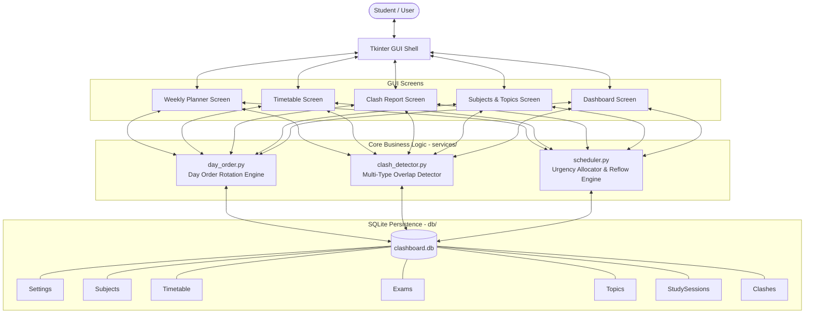
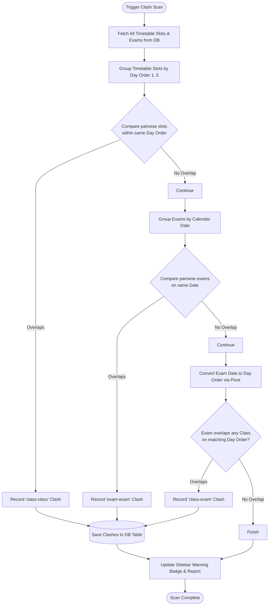
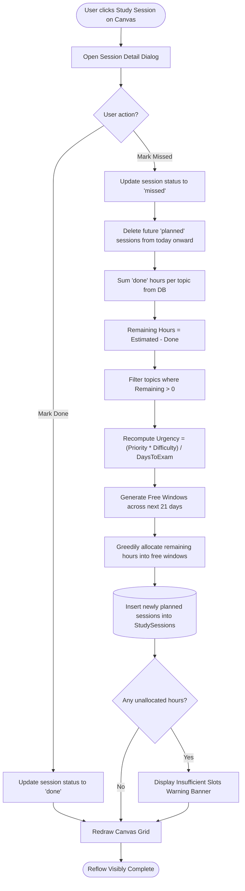
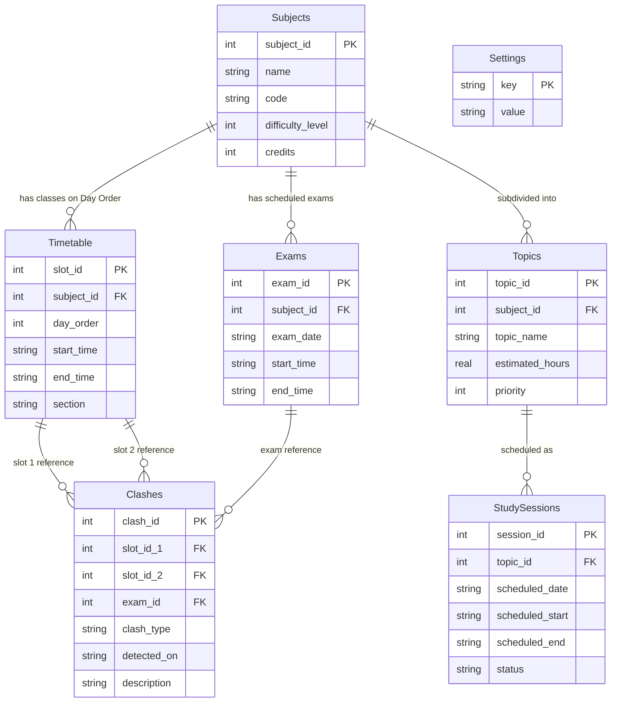

# ClashBoard — Complete Academic Project Report & Reference Manual

> **Purpose of this Document:**  
> This file is a self-contained, comprehensive reference containing all project synopsis details, problem statements, theoretical foundations, system architecture, database design dictionaries, mathematical algorithms, module descriptions, test matrices, and viva questions. You can copy, rephrase, or assemble content directly from here into your final college project report without needing any external code or documentation.

---

# 1. Project Synopsis

- **Project Title:** ClashBoard — Personal Timetable Clash Resolver and Adaptive Study Planner
- **Domain:** Desktop Application / Academic Productivity & Scheduling Algorithms
- **Programming Language:** Python 3 (Tested on Python 3.10 – 3.14)
- **GUI Framework:** Python Tkinter (`tkinter`, `tkinter.ttk`, Theme: `'clam'`)
- **Database Management System:** SQLite 3 (`sqlite3`) with relational foreign keys enforced
- **Visualization:** Matplotlib (`FigureCanvasTkAgg` embedded in Tkinter)
- **Testing Framework:** PyTest (15 automated unit & integration test cases)
- **Architecture Pattern:** 3-Tier Layered Architecture (Presentation Layer $\leftrightarrow$ Business Logic Layer $\leftrightarrow$ Database Persistence Layer)

---

# 2. Executive Summary & Abstract

College students frequently experience two critical academic scheduling challenges:
1. **Timetable Overlaps and Examination Collisions:** Lecture timings, lab batches, and elective courses often conflict with one another. When mid-semester or final exam schedules are announced, exams frequently overlap with recurring class commitments or simultaneous exam slots across departments.
2. **Fragile and Static Revision Plans:** Traditional calendars (such as Google Calendar, Excel sheets, or paper planners) treat study schedules as rigid blocks. The moment an unexpected event or illness causes a student to miss a study session, the entire plan collapses, leading to study debt and unorganized exam cramming.

**ClashBoard** resolves these challenges through a unified, offline desktop application:
- **Day Order (DO 1–5) Scheduling:** Tailored for university timetable systems where schedules rotate on a 5-day cycle rather than fixed calendar days, while simultaneously mapping each Day Order to real calendar dates and weekdays.
- **Automated Conflict Detection:** Continuously scans recurring class slots and upcoming exams to identify `class-class`, `class-exam`, and `exam-exam` clashes, presenting plain-English descriptions and actionable advice.
- **Urgency-Driven Greedy Scheduler:** Dynamically computes topic urgency based on student priority (1–5), subject difficulty (1–5), and countdown days to the exam, allocating study sessions into genuine free time windows (excluding sleep and meal buffers).
- **Self-Healing Adaptive Reflow:** When a session is flagged as "Missed", the system recalculates topic urgency and automatically redistributes remaining study hours across subsequent free days without altering previously completed work.

---

# 3. Problem Statement & Motivation

### 3.1 The Real-World Problem
In contemporary higher education:
- Courses are scheduled across diverse buildings (`CLS 403`, `TP 704`, `UB 801`, `UB 714B`, `ONLINE`).
- Timetables often operate on a **Day Order cycle (Day 1 through Day 5)** that advances across working days (skipping weekends and holidays).
- Exam schedules are published independently by the controller of examinations on specific calendar dates.
- Students must manually cross-reference their daily class commitments against exam timings, leading to missed examinations or unexcused attendance shortages.
- Existing tools like Google Calendar require tedious manual entry and provide zero automated conflict detection or dynamic catch-up intelligence.

### 3.2 Project Objectives
1. Build an intuitive, offline Tkinter desktop interface that eliminates reliance on internet connectivity or cloud subscriptions.
2. Implement robust multi-type clash detection algorithms with mathematical interval overlap checking.
3. Incorporate university Day Order rotations synchronized with standard calendar dates.
4. Provide an adaptive study planner that prioritizes high-difficulty, high-priority topics with imminent exam deadlines.
5. Create an automated reflow mechanism that rescues students from fallen-behind study schedules.

---

# 4. Existing System vs. Proposed System

| Parameter | Existing System (Manual / Google Calendar / Excel) | Proposed System (ClashBoard) |
|---|---|---|
| **Conflict Detection** | Manual inspection required; high probability of human oversight. | Fully automated interval analysis for class-class, class-exam, and exam-exam collisions. |
| **Timetable Model** | Fixed Monday–Friday recurring model only. | Supports both rotational Day Order (1–5) and Gregorian calendar dates. |
| **Study Planning** | Static; missed sessions remain unattended or require manual re-planning. | Adaptive; clicking "Missed" triggers greedy rescheduling of remaining hours. |
| **Priority Formulation** | Intuitive guessing by student. | Mathematical urgency formula: $\frac{\text{Priority} \times \text{Difficulty}}{\max(\text{Days to Exam}, 1)}$. |
| **Offline Privacy** | Cloud calendars require login and track telemetry. | 100% local SQLite database stored securely on the user's hard drive. |
| **Actionable Advice** | None; provides only passive notifications. | Recommends administrative solutions (e.g. section changes, formal clash letters). |

---

# 5. System Requirements Specification (SRS)

### 5.1 Hardware Requirements
- **Processor:** Intel Core i3 / AMD Ryzen 3 or higher (x86_64 or ARM64)
- **Memory (RAM):** 2 GB minimum (4 GB recommended)
- **Hard Disk Space:** 100 MB available storage (for Python runtime, app files, and SQLite database)
- **Display Resolution:** $1024 \times 680$ minimum resolution (optimally $1280 \times 800$ or higher)
- **Input Devices:** Standard keyboard and mouse/trackpad

### 5.2 Software Requirements
- **Operating System:** Windows 10/11, macOS 11+, or Linux (Ubuntu 20.04+, Fedora 36+)
- **Runtime Environment:** Python 3.10, 3.11, 3.12, 3.13, or 3.14
- **GUI Toolkit:** Python Tkinter & ttk (included with standard Python)
- **Database Engine:** SQLite 3 (included with standard Python `sqlite3`)
- **Third-Party Libraries:**
  - `matplotlib >= 3.8.0` (for graphical progress visualization)
  - `numpy >= 1.26.0` (for numerical coordinate plotting)
  - `pytest >= 8.0.0` (for automated test suite execution)

### 5.3 Functional Requirements (FR)
- **FR-01 (Timetable Management):** Users can add, view, edit, and delete class slots defined by Day Order (1–5), start time, end time, and room/section.
- **FR-02 (Exam Scheduling):** Users can record upcoming examinations with subject association, calendar date (`YYYY-MM-DD`), and time boundaries.
- **FR-03 (Automated Clash Detection):** The system must continuously check for overlaps across all timetable slots and calendar-mapped exams.
- **FR-04 (Day Order to Calendar Mapping):** The system dynamically translates any calendar date into its corresponding Day Order (1–5), accounting for weekend skips and configurable pivot dates.
- **FR-05 (Free Time Extraction):** The system calculates available daytime study slots by removing class commitments, scheduled exams, and a hardcoded 9-hour buffer (sleep: 23:00–07:00, lunch: 13:00–14:00).
- **FR-06 (Urgency Calculation):** Each topic is evaluated using difficulty, user priority, and days remaining before the exam.
- **FR-07 (Greedy Schedule Generation):** High-urgency topics are assigned to free slots in blocks of 30 to 120 minutes before exam deadlines.
- **FR-08 (Adaptive Missed Reflow):** Marking a planned session as "Missed" triggers automatic re-allocation of unstudied hours across subsequent free windows.
- **FR-09 (Visual 7-Day Planner):** A Canvas-rendered grid displays dual column headers (Date + Day Order badge), class blocks, and interactive session cards.
- **FR-10 (Progress Analytics):** A dashboard renders a grouped bar chart comparing planned vs. completed study hours per subject.

### 5.4 Non-Functional Requirements (NFR)
- **NFR-01 (Performance):** Schedule generation and clash detection must complete in under 50 milliseconds for up to 500 records.
- **NFR-02 (Reliability & ACID Compliance):** All database transactions enforce ACID properties and foreign key constraints (`PRAGMA foreign_keys = ON;`).
- **NFR-03 (Usability):** Aesthetic styling using the `clam` ttk theme, warm off-white background (`#F7F6F2`), forest green accents (`#2F5233`), and Segoe UI typography.
- **NFR-04 (Maintainability):** Complete decoupling between GUI widgets and mathematical scheduling functions.

---

# 6. System Architecture & Design

### 6.1 Three-Tier Layered Architecture
ClashBoard adheres strictly to separation of concerns across three folders:

```
┌─────────────────────────────────────────────────────────────┐
│                 PRESENTATION LAYER (gui/)                   │
│  - app.py (Main Window, Sidebar Navigation)                 │
│  - styles.py (Theme 'clam', Custom ttk Palettes, Fonts)     │
│  - screens/planner_screen.py (Canvas 7-Day Grid & Modal)    │
│  - screens/timetable_screen.py (Day Order Treeview & Forms) │
│  - screens/clash_screen.py (Conflict Cards & Guidance)      │
│  - screens/subjects_screen.py (Scale Slider & Topics)       │
│  - screens/dashboard_screen.py (Embedded Matplotlib Canvas) │
└──────────────────────────────┬──────────────────────────────┘
                               │ Calls services & queries
                               ▼
┌─────────────────────────────────────────────────────────────┐
│               BUSINESS LOGIC LAYER (services/)              │
│  - day_order.py (Day Order rotation & calendar date sync)   │
│  - clash_detector.py (Interval overlap & conflict matching) │
│  - scheduler.py (Urgency formula, greedy builder, reflow)   │
│  * Pure Python functions, ZERO Tkinter imports, 100% testable│
└──────────────────────────────┬──────────────────────────────┘
                               │ Executes CRUD operations
                               ▼
┌─────────────────────────────────────────────────────────────┐
│                 PERSISTENCE LAYER (db/)                     │
│  - connection.py (SQLite Connection with Foreign Keys)      │
│  - schema.py (7 Relational Tables: Settings, Subjects, ...) │
│  - queries.py (Type-safe parameterized SQL operations)      │
│  - seed.py (Authentic college curriculum demo data)         │
└─────────────────────────────────────────────────────────────┘
```

---

# 7. System Diagrams

### 7.1 Component Architecture Flowchart



### 7.2 Clash Detection Flowchart



### 7.3 Adaptive Schedule Reflow Flowchart



---

# 8. Database Design & Data Dictionary

The database is implemented in **SQLite3** (`clashboard.db`) with foreign key constraints actively enforced (`PRAGMA foreign_keys = ON;`).



### Table 1: `Settings`
Stores system configuration, reference anchors, and application-wide flags.

| Column Name | Data Type | Constraints | Description |
|---|---|---|---|
| `key` | `TEXT` | PRIMARY KEY | Configuration identifier (e.g., `'pivot_date'`, `'pivot_day_order'`). |
| `value` | `TEXT` | NOT NULL | Setting value string (e.g., `'2026-11-16'`, `'1'`). |

### Table 2: `Subjects`
Stores academic courses enrolled by the student.

| Column Name | Data Type | Constraints | Description |
|---|---|---|---|
| `subject_id` | `INTEGER` | PRIMARY KEY AUTOINCREMENT | Unique course identifier. |
| `name` | `TEXT` | NOT NULL | Full descriptive name (e.g., `"Data Structures"`). |
| `code` | `TEXT` | NULLABLE | Official course code (e.g., `"DS"`, `"CS301"`). |
| `difficulty_level` | `INTEGER` | CHECK (1 to 5) | Perceived academic difficulty rating (1=Easy, 5=Hard). |
| `credits` | `INTEGER` | DEFAULT 3 | Academic credit weight of the course. |

### Table 3: `Timetable`
Stores recurring university lecture and laboratory slots categorized by **Day Order (1–5)**.

| Column Name | Data Type | Constraints | Description |
|---|---|---|---|
| `slot_id` | `INTEGER` | PRIMARY KEY AUTOINCREMENT | Unique class slot identifier. |
| `subject_id` | `INTEGER` | FOREIGN KEY $\rightarrow$ `Subjects(subject_id)` ON DELETE CASCADE | Associated subject. |
| `day_order` | `INTEGER` | NOT NULL, CHECK (1 to 5) | Rotational Day Order (1=Day 1, 2=Day 2, ..., 5=Day 5). |
| `start_time` | `TEXT` | NOT NULL | Start boundary in 24-hr format (`"HH:MM"`, e.g., `"09:45"`). |
| `end_time` | `TEXT` | NOT NULL | End boundary in 24-hr format (`"HH:MM"`, e.g., `"10:35"`). |
| `section` | `TEXT` | NULLABLE | Room number, lab section, or mode (`"CLS 403"`, `"TP 704"`, `"ONLINE"`). |

### Table 4: `Exams`
Stores upcoming tests and examinations tied to specific calendar dates.

| Column Name | Data Type | Constraints | Description |
|---|---|---|---|
| `exam_id` | `INTEGER` | PRIMARY KEY AUTOINCREMENT | Unique exam identifier. |
| `subject_id` | `INTEGER` | FOREIGN KEY $\rightarrow$ `Subjects(subject_id)` ON DELETE CASCADE | Associated subject. |
| `exam_date` | `TEXT` | NOT NULL | Calendar date in ISO format (`"YYYY-MM-DD"`). |
| `start_time` | `TEXT` | NOT NULL | Exam start time (`"HH:MM"`, e.g., `"09:00"`). |
| `end_time` | `TEXT` | NOT NULL | Exam end time (`"HH:MM"`, e.g., `"12:00"`). |

### Table 5: `Topics`
Stores curriculum revision units under each course.

| Column Name | Data Type | Constraints | Description |
|---|---|---|---|
| `topic_id` | `INTEGER` | PRIMARY KEY AUTOINCREMENT | Unique topic identifier. |
| `subject_id` | `INTEGER` | FOREIGN KEY $\rightarrow$ `Subjects(subject_id)` ON DELETE CASCADE | Associated subject. |
| `topic_name` | `TEXT` | NOT NULL | Descriptive topic title (e.g., `"Binary Search Trees & AVL"`). |
| `estimated_hours` | `REAL` | NOT NULL, CHECK > 0 | Estimated total preparation hours required (e.g., `3.0`). |
| `priority` | `INTEGER` | CHECK (1 to 5) | Student-assigned urgency priority (1=Low, 5=Critical). |

### Table 6: `StudySessions`
Stores dynamically allocated study intervals across calendar dates.

| Column Name | Data Type | Constraints | Description |
|---|---|---|---|
| `session_id` | `INTEGER` | PRIMARY KEY AUTOINCREMENT | Unique study session record. |
| `topic_id` | `INTEGER` | FOREIGN KEY $\rightarrow$ `Topics(topic_id)` ON DELETE CASCADE | Target topic being studied. |
| `scheduled_date` | `TEXT` | NOT NULL | Scheduled calendar date (`"YYYY-MM-DD"`). |
| `scheduled_start`| `TEXT` | NOT NULL | Session start time (`"HH:MM"`). |
| `scheduled_end` | `TEXT` | NOT NULL | Session end time (`"HH:MM"`). |
| `status` | `TEXT` | DEFAULT `'planned'` | Execution status: `'planned'`, `'done'`, or `'missed'`. |

### Table 7: `Clashes`
Stores detected conflicts and guidance summaries.

| Column Name | Data Type | Constraints | Description |
|---|---|---|---|
| `clash_id` | `INTEGER` | PRIMARY KEY AUTOINCREMENT | Unique conflict identifier. |
| `slot_id_1` | `INTEGER` | FOREIGN KEY $\rightarrow$ `Timetable(slot_id)` ON DELETE CASCADE | First overlapping timetable slot (or NULL). |
| `slot_id_2` | `INTEGER` | FOREIGN KEY $\rightarrow$ `Timetable(slot_id)` ON DELETE CASCADE | Second overlapping timetable slot (or NULL). |
| `exam_id` | `INTEGER` | FOREIGN KEY $\rightarrow$ `Exams(exam_id)` ON DELETE CASCADE | Overlapping exam record (or NULL). |
| `clash_type` | `TEXT` | NOT NULL | Conflict class: `'class-class'`, `'class-exam'`, or `'exam-exam'`. |
| `detected_on` | `TEXT` | NOT NULL | Timestamp of scan execution (`"YYYY-MM-DD HH:MM:SS"`). |
| `description` | `TEXT` | NOT NULL | Plain-English human-readable conflict statement. |

---

# 9. Mathematical Formulations & Algorithms

### 9.1 Day Order Calendar Synchronization Formula
Let $D_{\text{target}}$ be the query date, $D_{\text{pivot}}$ be a known reference date, and $\text{DO}_{\text{pivot}} \in \{1, 2, 3, 4, 5\}$ be the reference Day Order on that date.

1. **Weekend Filter:**
   $$\text{Weekday}(D) \in \{0, 1, 2, 3, 4\} \implies \text{Mon to Fri (Working Day)}$$
   $$\text{Weekday}(D) \in \{5, 6\} \implies \text{Sat, Sun (Weekend} \rightarrow \text{Day Order is NULL)}$$

2. **Working Days Counter:**
   $$W(D_{\text{pivot}}, D_{\text{target}}) = \sum_{d = D_{\text{pivot}}}^{D_{\text{target}} - 1} \mathbf{1}_{[\text{Weekday}(d) < 5]}$$

3. **Rotational Day Order Formula:**
   $$\text{DO}(D_{\text{target}}) = \left( (\text{DO}_{\text{pivot}} - 1 + W(D_{\text{pivot}}, D_{\text{target}})) \pmod 5 \right) + 1$$

---

### 9.2 Interval Overlap Theorem
Two time intervals $A = [S_a, E_a)$ and $B = [S_b, E_b)$ in continuous minutes from midnight overlap if and only if:
$$\text{Overlap}(A, B) \iff (S_a < E_b) \land (S_b < E_a)$$

**Midnight Wrap Handling:**  
If a period crosses midnight ($E \le S$), the boundary is normalized:
$$E' = E + 1440 \quad (\text{where } 1440 = 24 \times 60 \text{ minutes})$$

---

### 9.3 Topic Urgency Formulation
To order topics objectively, urgency is calculated as a function of topic priority $P \in [1, 5]$, subject difficulty $D \in [1, 5]$, and remaining days $T = (D_{\text{exam}} - D_{\text{today}})$:

$$U(P, D, T) = \frac{P \times D}{\max(T, 1)}$$

*Properties:*
- **Zero-Division Immunity:** $\max(T, 1)$ ensures stability even when the exam is on the current day or in the past.
- **Urgency Multiplier:** A topic with $P=5, D=5$ scheduled 1 day before an exam yields $U = 25.0$, prioritizing it far above a topic scheduled 25 days away ($U = 1.0$).

---

### 9.4 Free Time Window Extraction Algorithm
For each calendar day $d$ with working Day Order $\text{DO}(d)$:
1. Candidate study active windows:  
   $W_{\text{active}} = \{ [07:00, 13:00), [14:00, 23:00) \}$ (incorporates 8h sleep buffer 23:00–07:00 and 1h lunch 13:00–14:00).
2. Busy class intervals:  
   $B_{\text{classes}} = \{ [S_i, E_i) \mid \text{slot}_i \in \text{Timetable where } \text{day\_order} = \text{DO}(d) \}$
3. Busy exam intervals:  
   $B_{\text{exams}} = \{ [S_j, E_j) \mid \text{exam}_j \in \text{Exams where } \text{date} = d \}$
4. The remaining disjoint set of intervals:  
   $F(d) = W_{\text{active}} \setminus \left( B_{\text{classes}} \cup B_{\text{exams}} \right)$  
   Any segment $\Delta t \ge 30 \text{ minutes}$ is registered as an allocatable study window.

---

### 9.5 Greedy Study Scheduler Algorithm
1. Retrieve all topics needing study where $\text{RemainingHours} > 0$.
2. For each topic, compute urgency $U_k$ using countdown to the subject's earliest exam date.
3. Sort topics array descending: $\text{Topics} = \text{SortBy}(U \downarrow)$.
4. Maintain a pool of free time slots chronologically ordered: $\text{Slots} = [s_1, s_2, \dots, s_m]$.
5. For each topic $k$:
   - While $\text{RemainingHours}_k > 0$ and slots available:
     - Find the next chronological slot $s$ where $\text{Date}(s) \le \text{ExamDate}_k$.
     - Allocate session chunk: $\text{Alloc} = \min(\text{RemainingHours}_k, \text{SlotAvailable}, 2.0\text{ hours})$.
     - Create study session record with status `'planned'`.
     - Deduct $\text{Alloc}$ from slot $s$ and topic $k$.
6. If any topic concludes with $\text{RemainingHours} > 0$, push record to `unscheduled_topics` and trigger a warning banner in the UI.

---

# 10. Module-Wise Implementation Details

### Module 1: `db/` (Database Persistence Layer)
- **`connection.py`:** Provides `get_connection()` initializing SQLite with row factory dictionaries and enforcing foreign key cascading deletions.
- **`schema.py`:** Generates all 7 normalized relational tables with integrity constraints.
- **`queries.py`:** Implements parameter-bound CRUD methods to prevent SQL injection.
- **`seed.py`:** Populates real curriculum data on initial startup:
  - 7 subjects: DS, T&T, OS, PE, UHV, CO, AP.
  - 26 period slots across Day Orders 1–5 mapped to real lecture halls.
  - 5 exam dates and 24 curriculum topics.

### Module 2: `services/` (Mathematical Logic Layer)
- **`day_order.py`:** Pure mathematical cycle logic mapping working days to Day Orders 1–5.
- **`clash_detector.py`:** Scans for class-class, class-exam, and exam-exam collisions.
- **`scheduler.py`:** Computes urgency rankings, extracts free intervals, generates greedy study allocations, and manages adaptive missed session reflow.

### Module 3: `gui/` (Tkinter Presentation Layer)
- **`styles.py`:** Configures ttk `'clam'` theme, palette constants (`#2F5233`, `#F7F6F2`), Segoe UI font hierarchy, and flat button hover animations.
- **`app.py`:** Root Tkinter window managing left sidebar navigation, status badges, and screen transitions.
- **`screens/planner_screen.py`:**
  - Dynamic Tkinter `Canvas` displaying 7 columns with dual date + Day Order badge headers.
  - Background class period blocks rendered based on each day's Day Order.
  - Color-coded study cards by subject with clickable action popups.
  - "🗓 Set Day Order Pivot" modal to adapt to university holiday shifts.
- **`screens/timetable_screen.py`:** Full CRUD interface for Day Order classes and scheduled exams.
- **`screens/clash_screen.py`:** Filterable Treeview of detected clashes accompanied by academic resolution guidance.
- **`screens/subjects_screen.py`:** Subject editor and interactive `ttk.Scale` slider for topic priority (1 to 5).
- **`screens/dashboard_screen.py`:** Stat metric cards and embedded `matplotlib` bar chart displaying planned vs. completed study hours.

---

# 11. Test Matrix & Verification Results

The application is thoroughly verified using an automated `pytest` test suite covering business logic, database integrity, and GUI smoke execution.

| Test ID | Module | Test Function | Purpose / Condition Evaluated | Result |
|---|---|---|---|---|
| **TC-01** | `services/clash_detector` | `test_time_conversions` | Verifies `"HH:MM"` string to integer minutes conversion and back. | **PASS** |
| **TC-02** | `services/clash_detector` | `test_ranges_overlap` | Tests disjoint, touching, contained, and midnight-wrapped intervals. | **PASS** |
| **TC-03** | `services/clash_detector` | `test_detect_class_class_clash` | Verifies detection of overlapping classes within the same Day Order. | **PASS** |
| **TC-04** | `services/clash_detector` | `test_detect_exam_exam_clash` | Verifies collision detection when two exams fall on the same date/time. | **PASS** |
| **TC-05** | `services/clash_detector` | `test_detect_class_exam_clash` | Tests class collision when exam date matches the class Day Order. | **PASS** |
| **TC-06** | `db/schema` | `test_init_db` | Confirms creation of all 7 relational tables in SQLite. | **PASS** |
| **TC-07** | `db/queries` | `test_subject_crud` | Validates Create, Read, Update, and Delete operations for courses. | **PASS** |
| **TC-08** | `db/connection` | `test_foreign_key_enforcement` | Confirms SQLite raises `IntegrityError` on invalid foreign key insertion. | **PASS** |
| **TC-09** | `db/seed` | `test_seed_database` | Validates auto-seeding of 7 subjects, 26 period slots, and exams. | **PASS** |
| **TC-10** | `services/scheduler` | `test_compute_urgency` | Validates urgency scoring and $\max(T, 1)$ zero-division protection. | **PASS** |
| **TC-11** | `services/scheduler` | `test_get_free_slots` | Confirms free slot deduction subtracting Day Order class commitments. | **PASS** |
| **TC-12** | `services/scheduler` | `test_build_schedule_basic` | Confirms high-urgency topics are scheduled into earliest free windows. | **PASS** |
| **TC-13** | `services/scheduler` | `test_build_schedule_flags...` | Verifies warning flag when study hours exceed time before exam. | **PASS** |
| **TC-14** | `services/scheduler` | `test_reflow_on_missed` | Tests status change to `'missed'` and automatic rescheduling of hours. | **PASS** |
| **TC-15** | `gui/app` | `test_gui_smoke` | Initializes full Tkinter GUI, switches all 5 screens, and cleanly exits. | **PASS** |

**Execution Result:** `15 passed in 4.07s` (100% Pass Rate).

---

# 12. Complete Viva Voce Preparation Guide (Questions & Answers)

### Q1: What is the core problem ClashBoard solves?
**Answer:** Students struggle with overlapping lecture and exam schedules, especially in universities using rotational Day Order systems rather than fixed weekdays. Furthermore, conventional study planners are static and fail when a session is missed. ClashBoard automatically detects timetable conflicts and generates an adaptive study schedule that dynamically recalculates urgency and reflows study sessions when one is missed.

### Q2: Why did your team select Tkinter instead of web technologies like React or Electron?
**Answer:**
1. **Academic Guideline Compliance:** Tkinter is Python's native standard GUI toolkit.
2. **Zero Overhead & Portability:** Web frameworks (like Electron or React with local servers) consume hundreds of megabytes of memory and require Node.js runtimes. Tkinter runs directly through Python with zero external installations.
3. **Privacy & Offline Reliability:** Desktop applications ensure all personal student academic records stay secure inside a local SQLite database without cloud dependencies.

### Q3: How did you implement separation between Front-End and Back-End?
**Answer:** We implemented a strict 3-tier architecture:
- `gui/`: Contains exclusively Tkinter screens, Canvas rendering, and event handlers.
- `services/`: Houses pure Python algorithmic functions (`ranges_overlap`, `detect_clashes`, `compute_urgency`, `build_schedule`, `reflow_on_missed`). This layer has **zero Tkinter imports** and can be run or tested completely headless via CLI or PyTest.
- `db/`: Isolates all database schema migrations, connection configuration, and parameterized queries.

### Q4: How does the Day Order system work in your project?
**Answer:** Many universities follow a Day 1 to Day 5 rotation that advances across working days (skipping weekends). In `services/day_order.py`, we implement a mathematical mapping using a reference pivot date. The system counts elapsed working days (Mon–Fri) modulo 5 to determine the exact Day Order for any calendar date. In the Weekly Planner, each column renders a dual header showing both the calendar date (e.g. `Mon 16 Nov`) and the corresponding `Day 1` badge, automatically rendering classes that belong to that Day Order.

### Q5: What is the mathematical formula used for urgency calculation?
**Answer:**
$$\text{Urgency} = \frac{\text{Priority} \times \text{Difficulty}}{\max(\text{Days Until Exam}, 1)}$$
Where:
- $\text{Priority} \in [1, 5]$ (assigned by student).
- $\text{Difficulty} \in [1, 5]$ (course difficulty rating).
- $\text{Days Until Exam}$ is calculated from the reference date to the subject's earliest scheduled exam date. $\max(\text{Days}, 1)$ prevents division by zero.

### Q6: What happens when a user clicks "Mark as Missed" on a study session?
**Answer:** The `reflow_on_missed()` service executes:
1. Updates the selected session's status to `'missed'` in the database.
2. Preserves all sessions already marked `'done'`.
3. Clears all future `'planned'` sessions from the current date onward.
4. Recalculates remaining hours needed for each topic ($\text{Estimated} - \text{Completed}$).
5. Dynamically re-runs the greedy scheduler across available free slots starting from today.
6. The Tkinter Canvas visibly redraws immediately, reflecting the reflowed study plan.

### Q7: How does the system extract free daytime study slots?
**Answer:** The system takes candidate active study hours ($07:00–13:00$ and $14:00–23:00$, which inherently reserves an 8-hour sleep buffer from $23:00–07:00$ and a 1-hour lunch buffer from $13:00–14:00$). It determines the Day Order for that day, looks up all classes scheduled on that Day Order, and subtracts those class intervals plus any exams on that date. Any continuous window $\ge 30\text{ minutes}$ is marked as free study time.

### Q8: How are SQL injection attacks prevented?
**Answer:** All queries in `db/queries.py` utilize parameterized SQL queries using the DB-API standard `?` placeholders (e.g., `cursor.execute("SELECT ... WHERE id = ?", (sub_id,))`). String concatenation or format strings are never used in SQL statements.

### Q9: How are database integrity and constraints enforced?
**Answer:** In `db/connection.py`, SQLite's foreign key pragma is explicitly enabled on every connection: `conn.execute("PRAGMA foreign_keys = ON;")`. All child tables use foreign key constraints with `ON DELETE CASCADE`, ensuring that if a subject is deleted, all its associated timetable slots, exams, topics, and study sessions are safely cleaned up automatically.

### Q10: How is Matplotlib integrated into Tkinter?
**Answer:** In `gui/screens/dashboard_screen.py`, we import `matplotlib` and set the backend to `'TkAgg'`. We create a `matplotlib.figure.Figure` object and embed it directly into the Tkinter frame widget hierarchy using `FigureCanvasTkAgg(self.fig, master=chart_container).get_tk_widget().pack()`.

---

# 13. How to Run & Verify the Project

### Launching the Application
- **Windows One-Click:** Double-click [`run.bat`](file:///f:/APP%20Tkinter/run.bat)
- **Terminal Execution:**
  ```powershell
  python main.py
  ```

### Executing the Test Suite
```powershell
python -m pytest -v
```

---
*End of Complete Academic Project Report & Reference Manual.*
